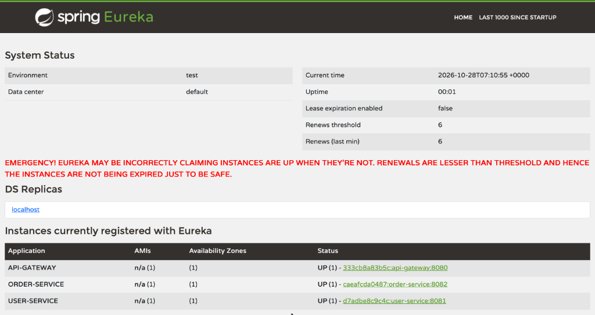
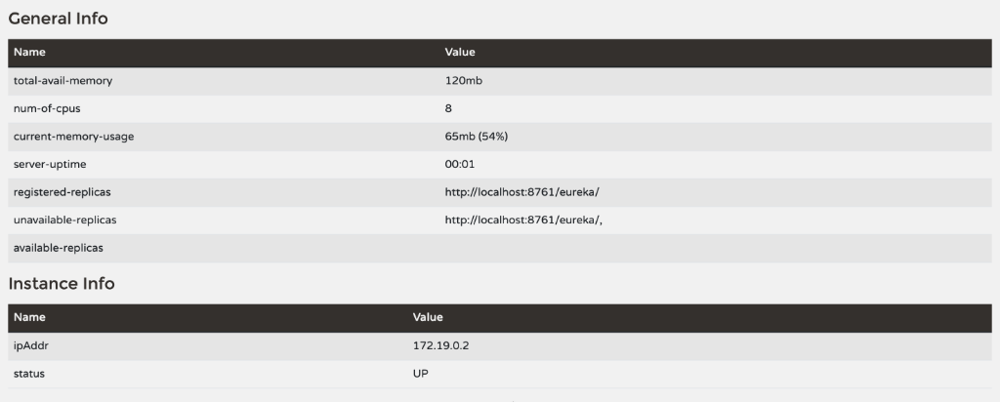

# Spring Boot Microservice Demo

A lightweight demonstration of a microservice architecture built with **Spring Boot 4**, **Spring Cloud 2025**, **Netflix Eureka**, **Spring Cloud Gateway**, and **OpenFeign**.

---

## 🏛️ Architecture Overview

```
                      ┌─────────────────────────┐
                      │   Client / Browser      │
                      └────────────┬────────────┘
                                   │ HTTP
                                   ▼
                      ┌─────────────────────────┐
                      │  API Gateway (:8080)    │
                      └─────┬─────────────┬─────┘
                            │             │
              /api/users/** │             │ /api/orders/**
                            ▼             ▼
             ┌───────────────────┐     ┌───────────────────┐
             │   User Service    │◄────┤   Order Service   │
             │      (:8081)      │ Feign      (:8082)      │
             └─────────┬─────────┘     └─────────┬─────────┘
                       │                         │
                       └───────────┬─────────────┘
                                   │ Register / Discover
                                   ▼
                      ┌─────────────────────────┐
                      │ Service Registry Eureka │
                      │         (:8761)         │
                      └─────────────────────────┘
```

### Components

| Service | Port | Description |
| :--- | :--- | :--- |
| **`service-registry`** | `8761` | Eureka Server for service registration and discovery |
| **`api-gateway`** | `8080` | Spring Cloud Gateway for centralized routing to microservices |
| **`user-service`** | `8081` | Handles user data and user-related APIs |
| **`order-service`** | `8082` | Handles orders and communicates with `user-service` via OpenFeign |

---

## 📋 Prerequisites

- **Java 17** or higher
- **Maven** (a wrapper `./mvnw` is included in the project)
- **Docker & Docker Compose** (optional, for containerized execution)

---

## 🛠️ Build the Project

Each service is an independent Maven project with its own `pom.xml` and Maven wrapper, so build them one by one. From the repository root:

```bash
for svc in service-registry user-service order-service api-gateway; do
  (cd "$svc" && ./mvnw clean package -DskipTests)
done
```

This creates `target/<service>-0.0.1-SNAPSHOT.jar` inside each service folder. To run the tests as well, drop `-DskipTests`.

> **Note:** Running `./mvnw` in the repository root does **not** build these services; the root `pom.xml` is a separate project.

---

## 🚀 Running the Applications

### Option 1: Run with Docker Compose (Recommended)

1. Make sure **Docker Desktop** is running.
2. Build the JARs first (see "Build the Project" above); each Dockerfile copies the JAR from its service's `target/` folder.
3. Start all services using Docker Compose:
   ```bash
   docker compose -f Docker-compose.yml up --build
   ```
   > **Note:** Run in the background using detached mode `-d`:
   > ```bash
   > docker compose -f Docker-compose.yml up --build -d
   > ```
4. Stop the services:
   ```bash
   docker compose -f Docker-compose.yml down
   ```

---

### Option 2: Run Locally (Without Docker)

Each service's `application.yml` points Eureka at `http://service-registry:8761/eureka/`, a hostname that only resolves inside Docker Compose. When running locally, override it with the property shown below on every service except the registry.

Run each service in a separate terminal window in the order listed below:

1. **Service Registry (Eureka Server):**
   ```bash
   java -jar service-registry/target/service-registry-0.0.1-SNAPSHOT.jar
   ```
   *Wait until Eureka starts at http://localhost:8761 before starting the other services.*

2. **User Service:**
   ```bash
   java -jar user-service/target/user-service-0.0.1-SNAPSHOT.jar \
     --eureka.client.service-url.defaultZone=http://localhost:8761/eureka/
   ```

3. **Order Service:**
   ```bash
   java -jar order-service/target/order-service-0.0.1-SNAPSHOT.jar \
     --eureka.client.service-url.defaultZone=http://localhost:8761/eureka/
   ```

4. **API Gateway:**
   ```bash
   java -jar api-gateway/target/api-gateway-0.0.1-SNAPSHOT.jar \
     --eureka.client.service-url.defaultZone=http://localhost:8761/eureka/
   ```

---

## 🧪 Testing the Endpoints

### 1. Eureka Dashboard
Open your browser and visit:
- **[http://localhost:8761](http://localhost:8761)**

Verify that `USER-SERVICE`, `ORDER-SERVICE`, and `API-GATEWAY` are actively registered:





### 2. User Service Endpoints (via API Gateway)
- **Get all users:**
  ```bash
  curl http://localhost:8080/api/users
  ```
- **Get user by ID:**
  ```bash
  curl http://localhost:8080/api/users/1
  ```

### 3. Order Service Endpoints (via API Gateway)
- **Get all orders:**
  ```bash
  curl http://localhost:8080/api/orders
  ```

### 4. Health Checks
- **User Service:** `curl http://localhost:8080/api/users/health`
- **Order Service:** `curl http://localhost:8080/api/orders/health`

### 5. Inter-Service Communication (OpenFeign)
Fetches an order and automatically calls `user-service` to enrich the response with customer details:
```bash
curl http://localhost:8080/api/orders/1/details
```

**Sample Response:**
```json
{
  "order": {
    "id": 1,
    "userId": 1,
    "product": "iPhone 15",
    "price": 89999.0,
    "status": "DELIVERED"
  },
  "user": {
    "id": 1,
    "name": "Ravi Kumar",
    "email": "ravi@gmail.com"
  }
}
```

### 6. Sample Data and Errors
Both services keep fake data in memory, so there is no database to set up.

| Resource | IDs available |
| :--- | :--- |
| Users | `1` (Ravi Kumar), `2` (Priya Devi), `3` (Karthik Raja) |
| Orders | `1`, `2`, `3` |

Requesting an ID that does not exist (for example `/api/users/99`) returns an HTTP 500 error, because the services throw a plain `RuntimeException` instead of returning 404.

---

## 📁 Project Structure

```
microservice-demo/
├── pom.xml                 # Standalone root project (not a parent of the services)
├── mvnw                    # Maven wrapper for the root project
├── Docker-compose.yml      # Docker compose definition for all services
├── README.md               # Documentation
├── service-registry/       # Eureka Discovery Server
├── api-gateway/            # Spring Cloud Gateway
├── user-service/           # User Microservice
└── order-service/          # Order Microservice (includes Feign client)
```

